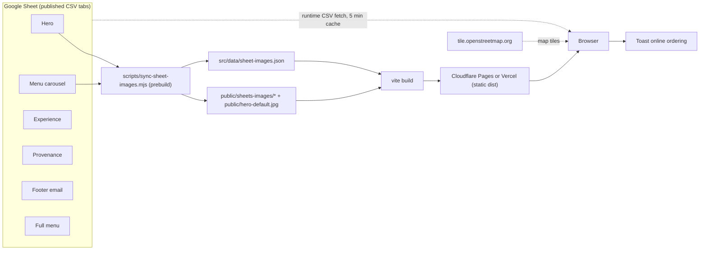
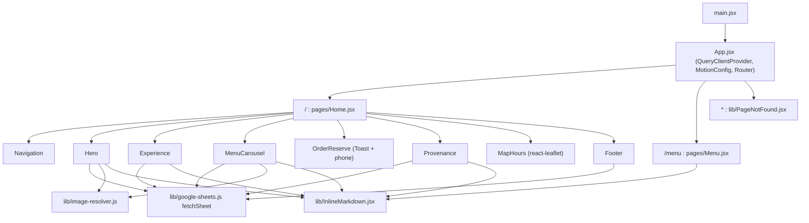

<div align="center">

# Tsuru Sushi

*Restaurant site for a Japanese sushi kitchen*

[](https://tsurusushi.com)
[](https://react.dev)
[](https://vite.dev)
[](https://tailwindcss.com)

[Overview](#overview) • [Content workflow](#content-workflow) • [Structure](#structure) • [Architecture](#architecture)

</div>

A single page site for Tsuru Sushi: menu, today's catch, the story behind the fish, hours and
directions, and every ordering and reservation route in one place. Content is owned by the
restaurant through a Google Sheet, so the menu changes without a deploy.

## Overview

Restaurant sites go stale because updating them requires a developer. This one is built so
the people running the kitchen can change what the site says.

- **Menu and daily catch driven by Google Sheets**, no CMS, no admin login
- **Images pulled and localized at build time** rather than hotlinked from Drive
- **Ordering routes in one place**: DoorDash, Grubhub and Uber Eats side by side
- **No runtime configuration**, the build is fully static and deploys anywhere

## Content workflow

The restaurant edits Google Sheets. A prebuild step localizes every referenced image so the
site never depends on Drive at runtime.

```
Google Sheets  ──►  npm run sync-images  ──►  public/sheets-images/
(staff edit)        download Drive images     src/data/sheet-images.json
                                                       │
                                                       ▼
                                              bundled and CDN served
```

`sync-sheet-images.mjs` runs automatically as `prebuild`, so a deploy always ships whatever
the staff have most recently entered.

> [!NOTE]
> Hotlinking Google Drive images directly was the original approach and it was slow and
> fragile, since Drive rate limits and rewrites URLs. Downloading at build time removed a runtime
> dependency and a whole class of broken images.

## Structure

```
src/
  pages/
    Home.jsx            composes the single page experience
    Menu.jsx            full menu view
  components/
    restaurant/         Hero, Navigation, MenuCarousel, Experience,
                        Provenance, TodaysCatch, Booking, OrderReserve,
                        MapHours, Footer
    ui/                 shared primitives
  lib/
    google-sheets.js    fetch and cache published Sheet CSV
    image-resolver.js   map Sheet image URLs to localized assets
    InlineMarkdown.jsx  light markdown for Sheet authored copy
scripts/
  sync-sheet-images.mjs Drive images to local assets + manifest
```

`InlineMarkdown` exists because staff write copy in spreadsheet cells and reasonably expect
bold and line breaks to work. It supports a deliberately small subset rather than pulling in a
full markdown parser for a handful of fields.

## Architecture

The build only localizes images, from the Hero and Menu carousel tabs. All text (menu, specials, story, contact email) is read from the published Sheet in the visitor's browser, through `lib/google-sheets.js` with a 5 minute memory and localStorage cache. The `/menu` page fetches its own tab directly. Hosting config exists for both Cloudflare Pages (`public/_headers`, `public/_redirects`) and Vercel (`vercel.json`), with matching SPA fallback, `/menu.html` redirect and CSP.



The home page is one scroll-snapped page; `/menu` is the full menu:


